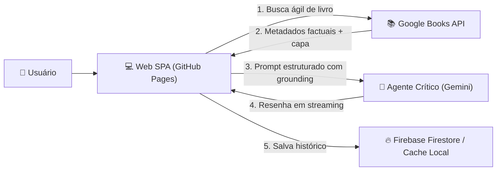

# Book Review Agent (AaaS Literário)

Aplicação Single Page Application (SPA) para resenhas críticas literárias automatizadas com agentes de inteligência artificial, projetada para rodar de forma 100% estática no **GitHub Pages** com persistência em tempo real no **Firebase (Firestore)**.

Construída sob a governança agêntica do **ECC (*Everything Claude Code*)**.

---

## 💡 Proposta de Valor & Arquitetura

O sistema atua como um assistente de referência analítica para escritores, críticos e leitores ávidos:



### Funcionalidades Chave:
1. **Identificação Ágil de Livros**: Busca em tempo real com debouncing consumindo a Google Books API pública (sem necessidade de backend intermediário).
2. **Crítica Estruturada em 5 Dimensões**:
   - *Visão Geral & Premissa*;
   - *Análise Temática & Subtexto*;
   - *Estilo Narrativo & Ritmo*;
   - *Pontos Fortes & Limitações Críticas*;
   - *Veredito Crítico & Recomendações*.
3. **Streaming Contínuo**: Visualização em tempo real conforme a resenha é redigida pelo agente de IA.
4. **Persistência Híbrida**: Grava no **Firebase Firestore** com fallback automático no `localStorage` (o app funciona imediatamente mesmo antes de configurar credenciais do Firebase).
5. **Cópia em 1-Clique**: Facilidade para transferir o texto analítico gerado para artigos, resenhas e publicações autorais.
6. **Aba de Histórico**: Navegação e consulta rápida de todas as resenhas salvas anteriormente.
7. **Deploy Automático no GitHub Pages**: Workflow nativo de CI/CD via GitHub Actions ([`.github/workflows/deploy.yml`](file:///home/willycornelissen/Desktop/Dablio/review/.github/workflows/deploy.yml)).

---

## 🛠️ Stack Tecnológica

* **Frontend**: React 19, TypeScript, Vite, Tailwind CSS, Lucide Icons.
* **Agente de IA**: Google Gemini API via streaming SSE direto no cliente.
* **Banco de Dados**: Firebase Firestore via Firebase JS SDK + fallback LocalStorage.
* **Catálogo de Livros**: Google Books API (CORS habilitado).
* **Testes & Tipagem**: Vitest, React Testing Library, TypeScript Strict.
* **Hospedagem & CI/CD**: GitHub Pages + GitHub Actions.

---

## 🚀 Como Executar Localmente

### 1. Clonar e Instalar Dependências
```bash
npm install
```

### 2. Rodar a Suíte de Testes Unitários
```bash
npm test
```

### 3. Iniciar Servidor de Desenvolvimento
```bash
npm run dev
```
Acesse `http://localhost:5173` no navegador.

### 4. Compilar para Produção (GitHub Pages)
```bash
npm run build
```
Os artefatos estáticos prontos para deploy são gerados no diretório `dist/`.

---

## ⚙️ Configuração de Chaves (Gemini & Firebase)

1. **Google Gemini API Key**:
   - Obtenha gratuitamente em [Google AI Studio](https://aistudio.google.com/app/apikey).
   - Pode ser inserida diretamente na interface pelo botão de **Configurações (⚙️)** no topo da página (salva com segurança no `localStorage` do seu navegador) ou via variável de ambiente `.env` (`VITE_GEMINI_API_KEY`).
2. **Firebase Firestore**:
   - Crie um projeto no console do Firebase e ative o Firestore Database.
   - Cole o objeto `firebaseConfig` no modal de configurações da aplicação ou configure as variáveis `VITE_FIREBASE_*`.
   - *Caso não configure o Firebase, o sistema utilizará o cache local (LocalStorage) sem interrupções.*

---

## 📋 Documentação e Esteira do ECC

* **PRD (Product Requirements Document)**: [`.claude/prds/book-review-agent.prd.md`](file:///home/willycornelissen/Desktop/Dablio/review/.claude/prds/book-review-agent.prd.md)
* **Plano Técnico de Implementação**: [`.claude/plans/book-review-agent.plan.md`](file:///home/willycornelissen/Desktop/Dablio/review/.claude/plans/book-review-agent.plan.md)
* **Diretrizes Agênticas**: [`AGENTS.md`](file:///home/willycornelissen/Desktop/Dablio/review/AGENTS.md)
